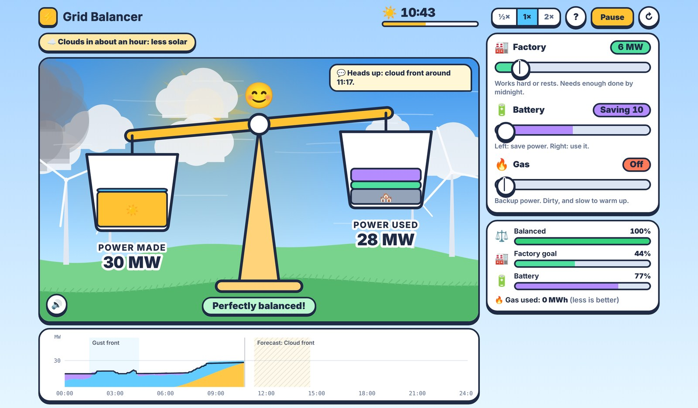

# Grid Balancer

A browser game about running an industrial microgrid (one day takes about 2.5 minutes, with ½× / 2× speed). Solar and wind follow the weather;
you steer a flexible factory, a battery and a gas genset to keep a balance scale level (power made = power used), hit the
factory's daily production target, and burn as little gas as possible.

Built with Vue 3 + TypeScript + Vite. No backend, no runtime dependencies beyond Vue.



## Run it

```bash
npm install
npm run dev        # http://localhost:5173
```

## Share it (nobody needs npm)

- **One file:** `npm run build:single` writes `dist-single/index.html`, a single 130 KB file with
  everything inside. Double-click it, attach it to an email, or put it on any file share.
- **A link, automatically:** push this repo to GitHub, then Settings -> Pages -> Source: "GitHub Actions".
  `.github/workflows/deploy.yml` publishes the game at `https://<user>.github.io/<repo>/` on every push.
- **A link, in 30 seconds:** drag the `dist/` folder onto https://app.netlify.com/drop

## Build and deploy

```bash
npm run build      # type-checks, then writes ./dist
```

`dist/` is a plain static site (relative paths). Drag the folder onto Netlify Drop, or push the repo
to Vercel / GitHub Pages.

## How it works

- `src/sim.ts` is the whole model: framework-free, deterministic (seeded weather), and runs headless.
  Weather events (gust front, cloud front, wind lull) are scheduled per seed and forecast ~2.5 h ahead.
- Frequency follows the supply/demand imbalance with a little inertia. Big surpluses trigger
  droop-style curtailment of renewables; big deficits trigger load shedding. Both cost money.
- The gas genset ramps slowly (18 MW/h) and the factory ramps fast, so planning ahead matters.
- Score = stability first (45%), then cost, CO₂ and production, which only count in proportion to
  how stable the grid was, so "do nothing" cannot farm a clean score.
- A short guided tour explains each source before the clock starts. Everything fits on one screen.
- The weather is felt, not read: `SceneBackdrop.vue` draws a live sky (dawn, day, dusk, night) with a warm
  sun when clear, grey clouds in a cloud front, streaks, leaves and spinning turbines in gusts, and mist,
  dust, fireflies and birds when calm. The page background takes the same colours.
- `ambience.ts` synthesizes the sound with WebAudio (no audio files): wind that swells with gusts, birds on
  calm sunny days, crickets at night. It starts after the first click, goes quiet on pause, and has a mute
  button (remembered in localStorage).
- At the end you get 0-3 stars, and the same day is replayed headless with a rule-based "robot operator"
  (forecast-aware) as a rival, plus plain-language tips about where the gas and the wasted wind went.

`npm run check` runs the headless simulation over several seeds and prints naive vs. autopilot
scores (roughly 35 vs. 80 on the current tuning).

## Known simplifications

It is a toy: one bus, no network constraints, hourly-smooth load profiles, a single battery, and
made-up prices. The autopilot is a heuristic, not an optimiser.
